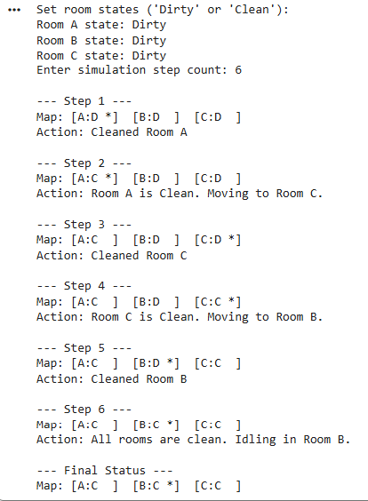

# TA2: Rule-Based Vacuum Agent Simulation

## 📌 Project Overview
This repository contains a Python implementation of a rule-based intelligent agent. Designed as a conceptual vacuum cleaner, the agent operates in a discrete environment, making autonomous decisions based on predefined condition-action rules to clean a series of rooms. 

This project serves as Technical Assessment 2 (TA2) for CS0065 (Intelligent Systems), demonstrating how rule-based architectures perceive their environment, update state data, and execute target-oriented actions.

## 📂 Repository Structure
- `TA2_VacuumAgent.ipynb`: The Google Colab Python notebook (or `.py` script) containing the environment setup, agent logic, and visualization methods.
- `TA2_Pepito.pdf`: The compiled laboratory report featuring execution screenshots, grid map outputs, and answers to the simulation analysis questions.

## 🧠 Simulation Mechanics & Features
The agent operates using a strictly defined "perceive-and-act" lifecycle. For this assessment, the standard laboratory requirements were expanded to include the advanced bonus tasks:

- **Condition-Action Rules:** If the current room is "Dirty", the agent cleans it. If the current room is "Clean", the agent moves.
- **Dynamic 3-Room Pathing:** Expanded from a simple 2-room toggle to a 3-room environment (Rooms A, B, C). When moving, the agent scans the environment dictionary and randomly selects the next dirty room to target.
- **Intelligent Idling:** If the agent perceives that all rooms in the grid are clean, it bypasses the movement rule and enters an idle state to conserve actions.
- **Text-Grid Visualization:** Renders a dynamic terminal-based map at each step, tracking room states (`D` for Dirty, `C` for Clean) and the live coordinates of the agent (`*`).

## 🚀 Usage Instructions
This script relies entirely on built-in Python functionality and requires no external dependencies or installations.

1. **Open Environment:** Upload the `.ipynb` file to Google Colab or open the script in your preferred local IDE (VSCode, PyCharm).
2. **Run the Script:** Execute the cell or run the Python file.
3. **Input Parameters:** 
   - When prompted, initialize the environment by typing `Dirty` or `Clean` for Rooms A, B, and C.
   - Enter an integer for the total number of simulation steps.
4. **View Results:** The terminal will output the step-by-step logic, the visual grid map, and the agent's specific actions until the step count is reached.

## 👤 Author
- [**Alexies Hyro Pepito**](https://github.com/Seixelax)