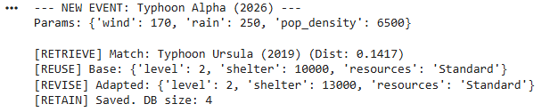

# TA3: Quantitative Case-Based Reasoning for Disaster Response

## 📌 Project Overview
This repository contains a mathematical implementation of a Case-Based Reasoning (CBR) Decision Support System (DSS) for disaster response. The model leverages historical meteorological and demographic feature vectors to compute deterministic resource allocation strategies for novel disaster events (e.g., typhoons). 

This project was developed for CS0065 (Intelligent Systems) to demonstrate the quantitative rigor required in the retrieval and adaptation phases of the CBR lifecycle.

## 🧮 Algorithmic Methodology

The system executes the standard CBR cycle (Retrieve, Reuse, Revise, Retain) with a strict focus on algorithmic stability and continuous numerical data processing:

- **State Representation:** Historical events are stored as feature vectors with continuous numerical features (wind speed, rainfall volume, population density) mapped to specific target variables (evacuation tier, shelter capacity).
- **Similarity Metric (Retrieve):** Implements a **Normalized Euclidean Distance** algorithm. To prevent high-magnitude variables (like population) from mathematically overpowering lower-magnitude variables (like wind speed), all features are normalized against predefined theoretical maximums before the geometric cost function is applied.
- **Dynamic Scaling (Revise):** Utilizes a deterministic scalar adjustment for target variable adaptation. The model computes a population density ratio between the novel event and the closest historical analog, applying this scalar to dynamically calculate the required shelter capacity without relying on rigid heuristic thresholds.

## 📂 Repository Structure
- `TA3_CBR_System.ipynb`: The core Python simulation containing the knowledge base, normalization constants, and the mathematical distance/adaptation functions.
- `TA3_PEPITO.pdf`: The compiled analytical report detailing the methodology, feature variance handling, and execution outputs.

## 🚀 Execution
The model relies entirely on standard Python standard libraries (`math`). 

1. Initialize the script or run the Colab notebook.
2. The system automatically ingests the test case (`Typhoon Alpha (2026)`), vectorizes its parameters, and runs the distance cost function against the historical database.
3. The terminal outputs the retrieved historical analog, the calculated similarity distance, the scaled adaptation values, and updates the state of the database.

## 👤 Author
- [**Alexies Hyro Pepito**](https://github.com/Seixelax)