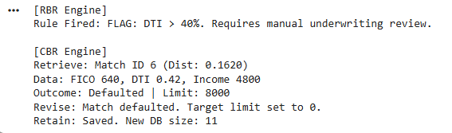

# TA4: Quantitative Credit Default Modeling: Deterministic vs. Statistical Reasoning Architectures

## 📌 Project Overview
This repository contains a dual-engine credit risk assessment model comparing Rule-Based Reasoning (RBR) and Case-Based Reasoning (CBR). Built for CS0065 (Intelligent Systems), this project demonstrates how different AI architectures process financial feature vectors (Fair Isaac Corporation score, Debt-to-Income ratio, and Income) to evaluate loan default risk and dynamically allocate credit limits.

## 🧮 Algorithmic Methodology

The system executes two distinct reasoning engines to compare deterministic compliance against statistical risk adaptation:

### 1. Rule-Based Reasoning (RBR) Engine
- **Architecture:** Deterministic Inference Engine.
- **Function:** Applies strict, hard-coded underwriting thresholds to the target applicant. 
- **Use Case:** Mimics traditional banking compliance, returning boolean flags for hard rule violations (e.g., Debt-to-Income > 40% triggers a manual review).

### 2. Case-Based Reasoning (CBR) Engine
- **Architecture:** 4R Cycle (Retrieve, Reuse, Revise, Retain) with continuous variable scaling.
- **Similarity Metric (Retrieve):** Implements a **Weighted Z-Score Euclidean Distance**. Features are standardized using population mean and variance to handle financial outliers, and weighted based on predictive power (Debt-to-Income carries a higher penalty than raw income).
- **Dynamic Adaptation (Revise):** Evaluates the historical default status of the closest quantitative match. If the analog defaulted, the system mathematically mitigates risk by reducing the target's approved limit to 0. If paid, it applies a scalar ratio to adjust the credit limit.

## 📂 Repository Structure
- **TA4_Risk_Engine.ipynb:** The self-contained Colab notebook housing the knowledge base, inference engine, distance algorithms, and execution loops.
- **TA4_PEPITO.pdf:** The compiled analytical report detailing the feature engineering, execution outputs, and architectural comparison.

## 🚀 Execution

The script relies entirely on standard Python libraries (`math`).

1. Execute the Python file or Colab cell.
2. The `applicant_facts` dictionary is processed first by the RBR engine, outputting regulatory flags.
3. The CBR engine then vectorizes the applicant, computes the statistical distance against the 10-record historical case base, and outputs the tailored risk adaptation.
4. The terminal displays the comparative outputs side-by-side for analytical review.

## 👤 Author
- [**Alexies Hyro Pepito**](https://github.com/Seixelax)
